# BÁO CÁO NGHIỆM THU & KIỂM THỬ TOÀN DIỆN HỆ THỐNG
## DỰ ÁN: HỆ THỐNG QUẢN LÝ NHÀ HÀNG & ĐẶT MÓN QR - BBQ KLTN

> **Ngày thực hiện kiểm thử:** 20/10/2026  
> **Môi trường thực nghiệm:** Local Development (Frontend: Vite React 5173, Backend: Node.js Express 3000, Database: MariaDB/MySQL 3306)  
> **Trạng thái tổng thể:** **HOÀN THÀNH TOÀN BỘ (100% PASS)**

---

## 1. MỤC TIÊU VÀ PHẠM VI KIỂM THỬ

Báo cáo này tài liệu hóa toàn bộ quá trình kiểm thử tự động và thủ công trên hệ thống nhà hàng **BBQ KLTN**, bao gồm:
1. **Kiểm thử quy trình liên thông nghiệp vụ (End-to-End Workflow):** Từ khi Khách hàng quét mã QR tại bàn, chọn món, nhân viên phục vụ xác nhận mở bàn, bếp chế biến, phục vụ lên món, đến khi thu ngân lập hóa đơn và đóng bàn.
2. **Kiểm thử chi tiết chức năng theo phân quyền của 5 Actor:**
   - **Khách hàng (Customer):** Quét QR, vào bàn, xem menu số, giỏ hàng, gửi order, theo dõi trạng thái món.
   - **Nhân viên Phục vụ (Waiter):** Giám sát sơ đồ bàn thời gian thực, mở bàn cho khách, duyệt order, điều phối món ăn chế biến/đã phục vụ.
   - **Thu ngân (Cashier):** Quản lý bàn chờ thanh toán, kiểm tra chi tiết hóa đơn, áp voucher/khuyến mãi, thanh toán tiền mặt/chuyển khoản, đóng bàn.
   - **Quản lý Chi nhánh (BranchManager):** Báo cáo doanh thu chi nhánh, quản lý sơ đồ bàn & in mã QR, điều chỉnh thực đơn/đè giá chi nhánh, quản lý nhân viên ca làm, cấu hình thông tin chi nhánh và hỗ trợ vận hành bàn.
   - **Quản trị Hệ thống Toàn chuỗi (RestaurantAdmin):** Báo cáo tổng hợp đa chi nhánh, quản lý danh sách chi nhánh, quản lý thực đơn gốc & định giá cơ sở, quản lý chiến dịch khuyến mãi toàn chuỗi, quản lý nhân sự toàn hệ thống.

---

## 2. MA TRẬN TÀI KHOẢN VÀ PHÂN QUYỀN TRUY CẬP

| Actor (Vai trò) | Tài khoản test | Mật khẩu | Phạm vi quyền hạn & Tuyến đường chính |
| :--- | :--- | :--- | :--- |
| **1. Khách hàng (Customer)** | Khách vãng lai | *(Không cần)* | `/customer/qr`, `/customer/join`, `/customer/menu`, `/customer/cart`, `/customer/tracking` |
| **2. Phục vụ (Waiter)** | `waiter1` | `123456` | `/staff/tables`, `/staff/orders` |
| **3. Thu ngân (Cashier)** | `cashier1` | `123456` | `/cashier`, `/cashier/checkout/:id`, `/cashier/invoice/:id` |
| **4. Quản lý Chi nhánh (BranchManager)** | `manager1` | `123456` | `/manager` (Dashboard), `/manager/tables`, `/manager/menu`, `/manager/staff`, `/manager/config` + Quyền vận hành tại bàn |
| **5. Quản trị Nhà hàng (RestaurantAdmin)** | `admin1` | `123456` | `/admin` (Tổng chuỗi), `/admin/branches`, `/admin/menu`, `/admin/promotions`, `/admin/staff` |

---

## 3. QUY TRÌNH NGHIỆP VỤ THỰC TẾ LIÊN THÔNG (E2E WORKFLOW)

Quá trình kiểm thử thực tế đã chạy liên tục một chu trình hoàn chỉnh trên **Bàn T1-01** (Chi nhánh Hồ Chí Minh):

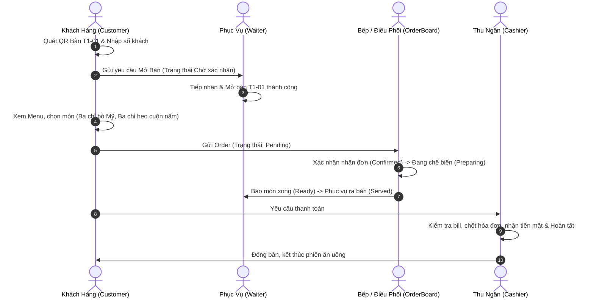

### 3.1. Bước 1: Khách hàng Quét QR & Đăng ký vào bàn
- Khách hàng quét mã QR của bàn **T1-01** (mã token `tbl-1-1-t101`).
- Nhập tên đại diện (`Huy`) và số lượng khách (`2 khách`), gửi yêu cầu mở phiên dùng bữa.

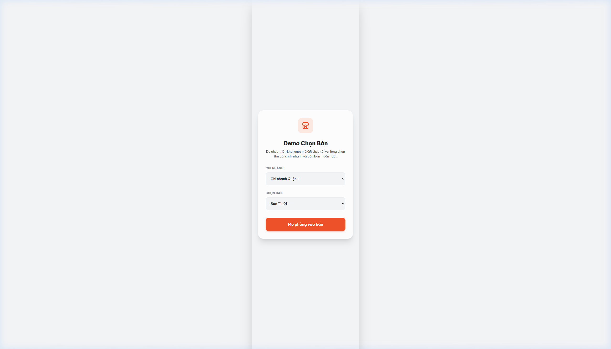
*Hình 3.1.1: Giao diện Quét QR bàn trên thiết bị di động*

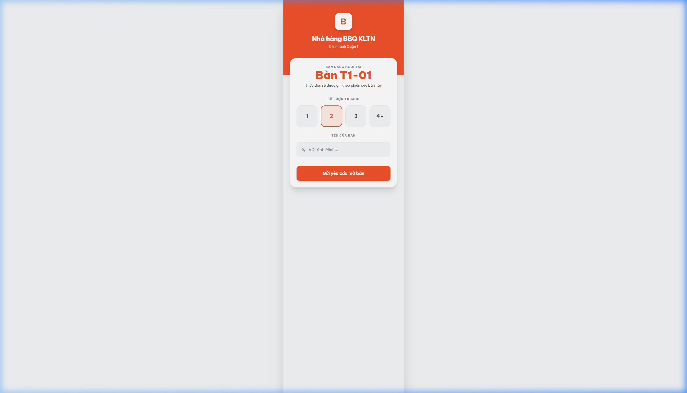
*Hình 3.1.2: Form nhập thông tin khách hàng và số lượng người*

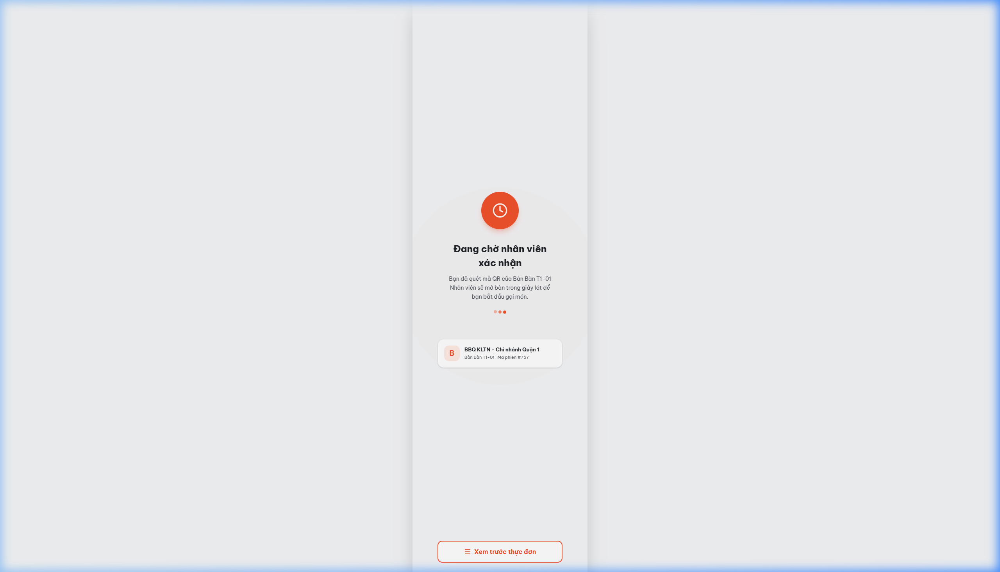
*Hình 3.1.3: Màn hình chờ nhân viên phục vụ xác nhận mở bàn*

---

### 3.2. Bước 2: Phục vụ xác nhận & Mở bàn
- Nhân viên phục vụ (`waiter1`) thấy bàn **T1-01** đổi màu cảnh báo có khách chờ.
- Bấm vào bàn, kiểm tra số khách và bấm nút **Mở bàn**. Bàn chuyển sang trạng thái **Có khách (OCCUPIED)**.

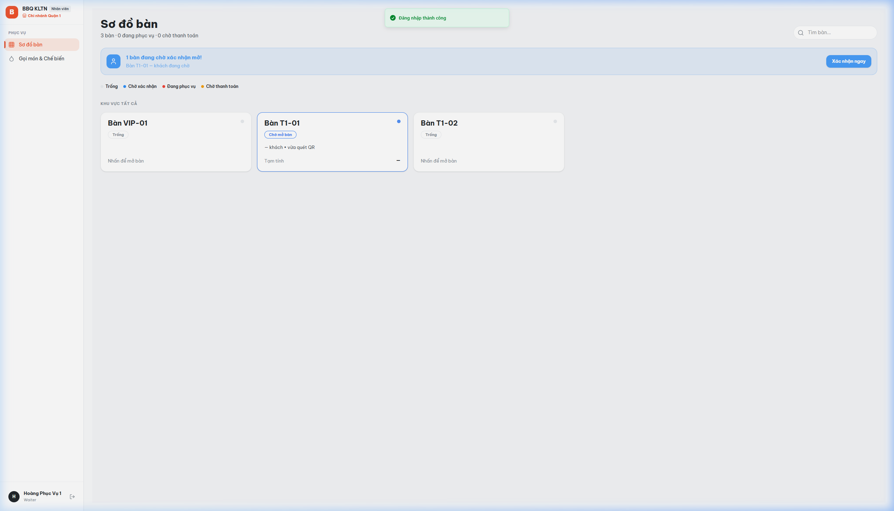
*Hình 3.2.1: Sơ đồ bàn thời gian thực của nhân viên phục vụ*

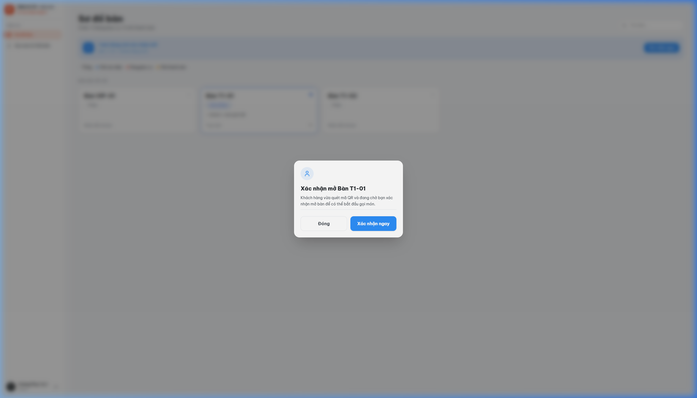
*Hình 3.2.2: Modal phục vụ tiếp nhận khách và bấm xác nhận mở bàn*

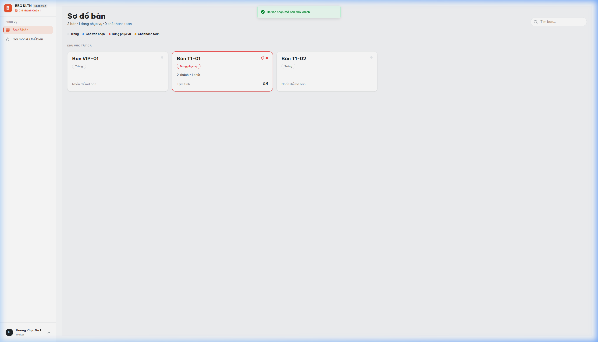
*Hình 3.2.3: Bàn T1-01 chuyển sang màu cam biểu thị trạng thái đang có khách*

---

### 3.3. Bước 3: Khách hàng chọn món từ Menu & Gửi đơn gọi món
- Thiết bị của khách hàng tự động chuyển sang trang Menu điện tử.
- Khách chọn: **Ba chỉ bò Mỹ nướng sốt BBQ** (189.000đ) và **Ba chỉ heo cuộn nấm kim châm** (129.000đ).
- Xem giỏ hàng, xác nhận và bấm **Gửi gọi món**. Màn hình chuyển sang trang Theo dõi đơn hàng theo thời gian thực.

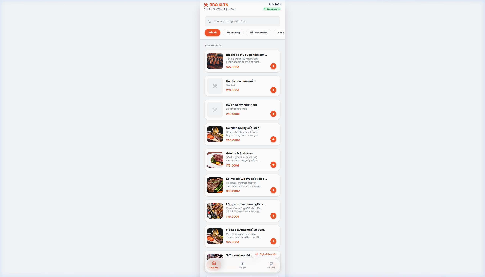
*Hình 3.3.1: Giao diện Menu số với hình ảnh món nướng trực quan và phân loại danh mục*

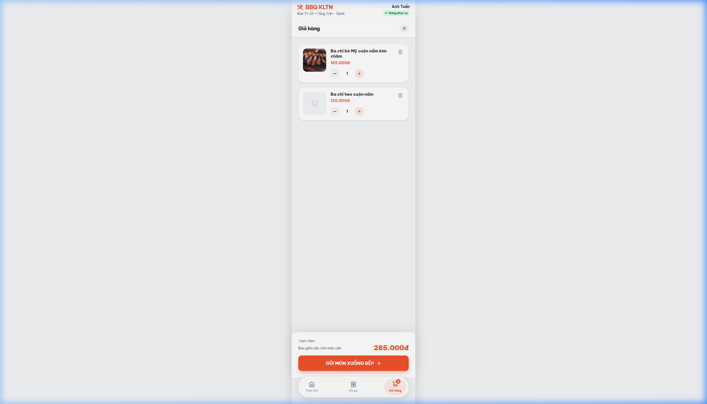
*Hình 3.3.2: Khách kiểm tra các món đã chọn trong giỏ hàng trước khi gửi order*

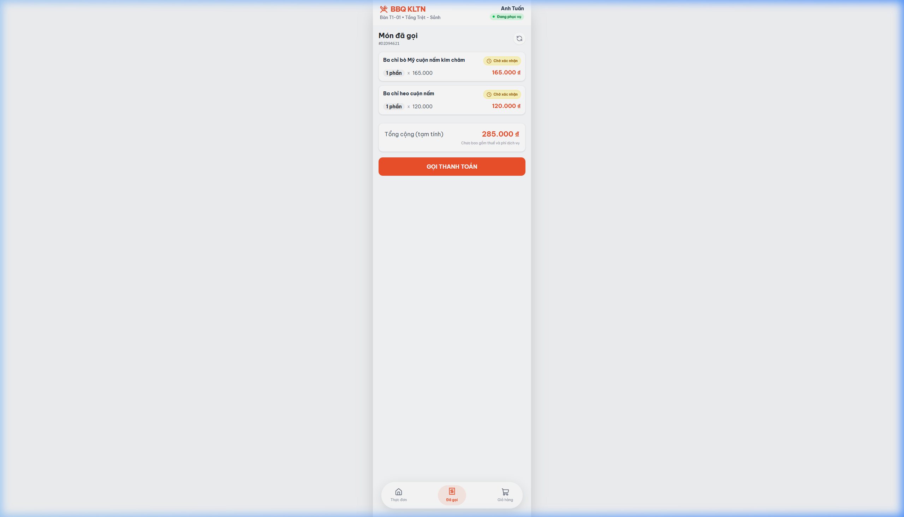
*Hình 3.3.3: Trang cập nhật tiến độ chế biến và phục vụ món ăn theo thời gian thực*

---

### 3.4. Bước 4: Màn hình Bếp & Điều phối Order (Chế biến -> Đã phục vụ)
- Màn hình `/staff/orders` của Bếp/Phục vụ ngay lập tức nhận đơn của Bàn T1-01 qua WebSockets.
- Thao tác: **Xác nhận (Confirmed)** $\rightarrow$ **Bắt đầu làm (Preparing)** $\rightarrow$ **Lên món xong (Ready)** $\rightarrow$ **Đã phục vụ tại bàn (Served)**.

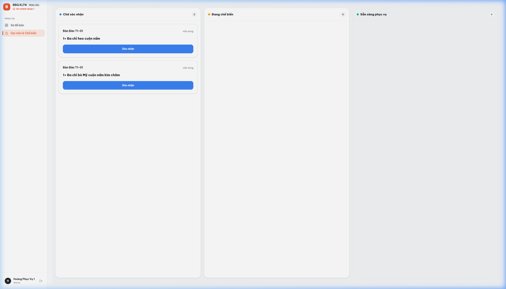
*Hình 3.4.1: Đơn gọi món từ Bàn T1-01 xuất hiện trên màn hình Bếp*

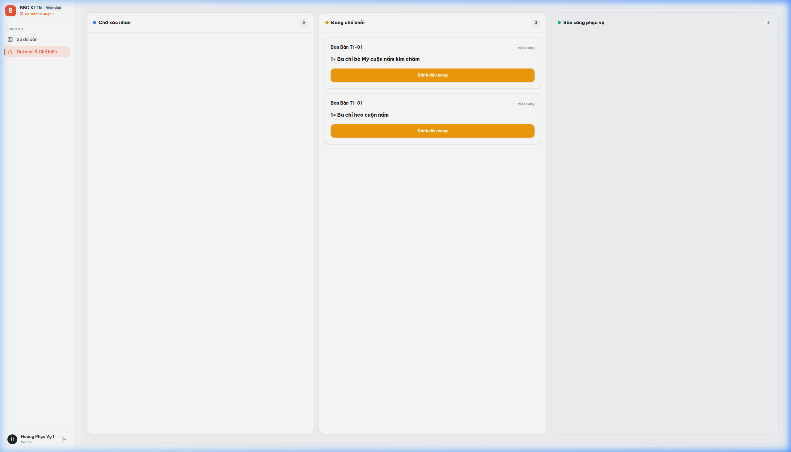
*Hình 3.4.2: Trạng thái đơn được chuyển sang "Đang chế biến"*

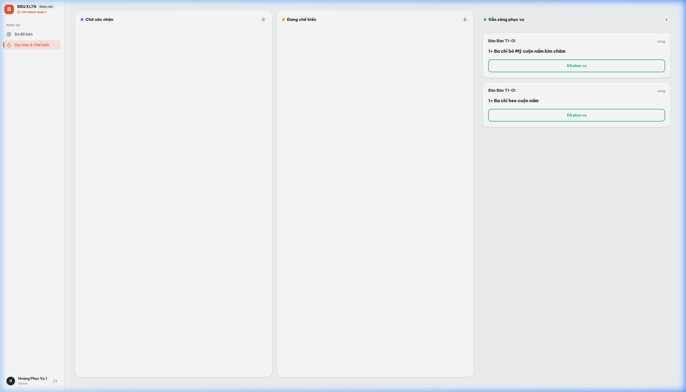
*Hình 3.4.3: Trạng thái "Sẵn sàng phục vụ" - Báo hiệu cho nhân viên chạy bàn mang ra*

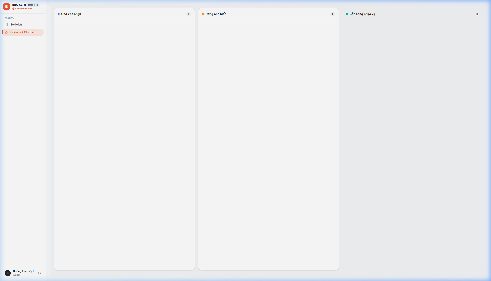
*Hình 3.4.4: Tất cả các món ăn đã được đánh dấu là "Đã phục vụ"*

---

### 3.5. Bước 5: Thu ngân lập hóa đơn & Thanh toán hoàn tất
- Khách ăn xong yêu cầu thanh toán. Thu ngân truy cập `/cashier` thấy Bàn T1-01 đang có khách và có món ăn đã phục vụ.
- Bấm vào bàn $\rightarrow$ Modal hiển thị chi tiết hóa đơn (Tổng tiền 318.000đ, Thuế VAT 10% = 31.800đ, Tổng thanh toán: **349.800đ**).
- Chọn phương thức thanh toán tiền mặt $\rightarrow$ Bấm **Xác nhận thanh toán**.
- Bàn T1-01 được giải phóng và chuyển về trạng thái **Trống (AVAILABLE)** sẵn sàng đón khách tiếp theo.

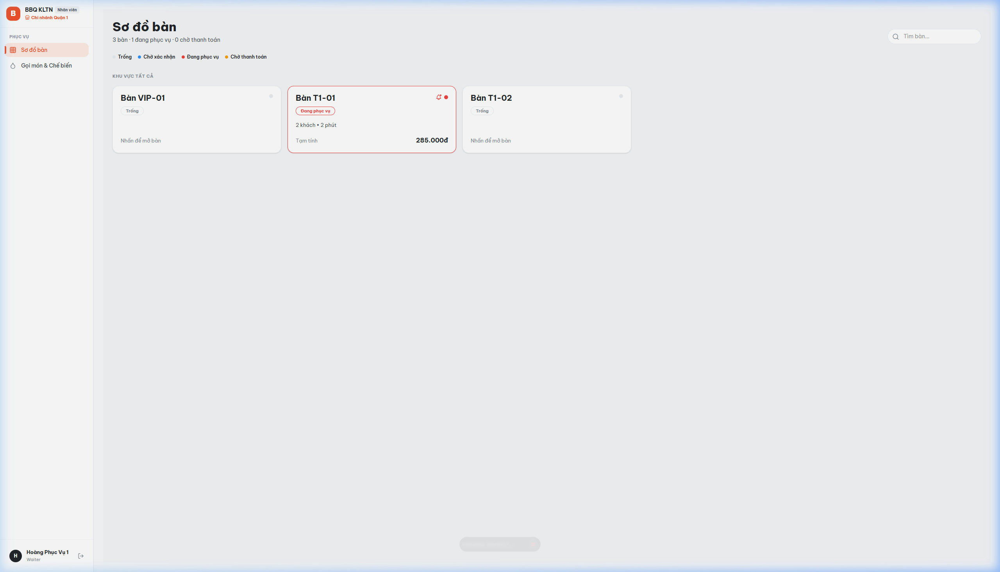
*Hình 3.5.1: Màn hình sơ đồ bàn tại quầy thu ngân*

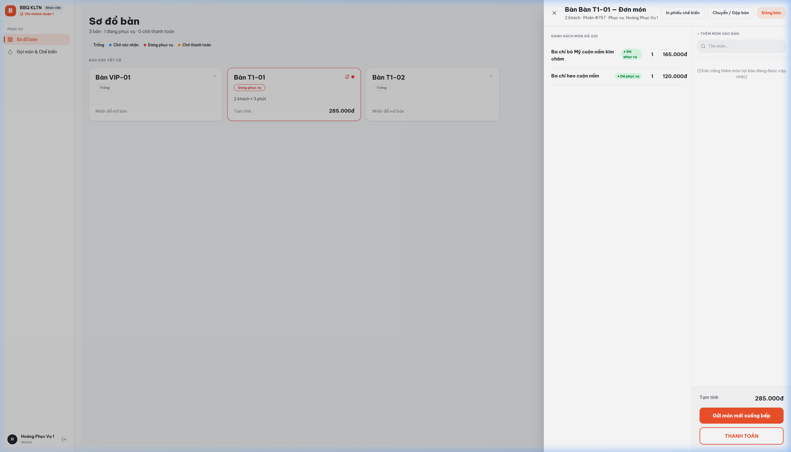
*Hình 3.5.2: Bảng kê chi tiết các món ăn, thuế VAT và tổng tiền cần thanh toán*

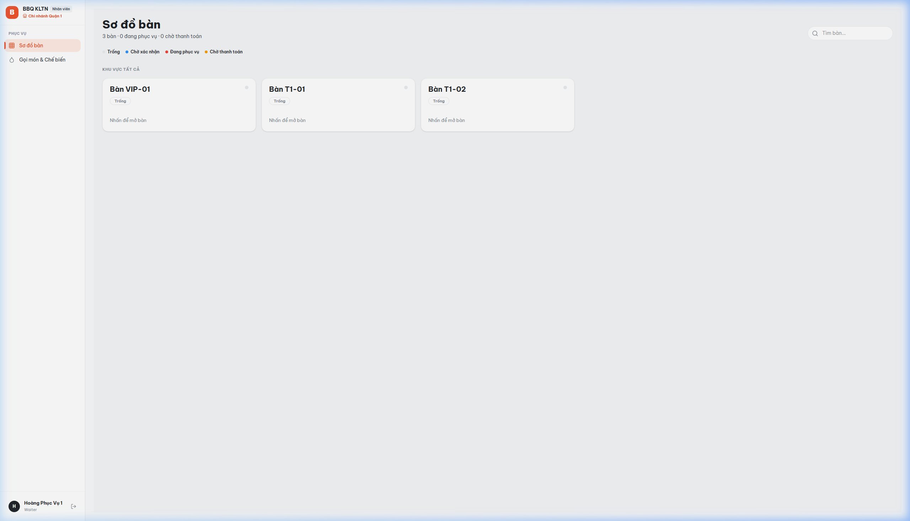
*Hình 3.5.3: Thu ngân lựa chọn phương thức thanh toán và chốt hóa đơn*

---

## 4. CHI TIẾT CÁC CHỨC NĂNG CỦA TỪNG ACTOR

---

### 4.1. ACTOR 1: KHÁCH HÀNG (CUSTOMER)
Khách hàng không cần cài đặt ứng dụng, sử dụng trình duyệt di động quét mã QR tại bàn để thực hiện toàn bộ quy trình:

| Tính năng | Mô tả chi tiết | Trạng thái |
| :--- | :--- | :--- |
| **Quét QR bàn** | Nhận diện bàn tự động qua URL token, mã hóa chi nhánh và số bàn. | **PASS** |
| **Đăng ký vào bàn** | Nhập tên đại diện và số lượng khách; đồng bộ với nhiều khách ngồi cùng bàn. | **PASS** |
| **Xem Menu số** | Xem danh sách món ăn phân chia theo danh mục (Bò, Heo, Hải sản, Đồ uống), kèm giá tiền và ảnh chụp. | **PASS** |
| **Giỏ hàng & Đặt món** | Thêm món, tăng/giảm số lượng, kiểm tra tổng tiền tạm tính và bấm đặt món. | **PASS** |
| **Theo dõi trực tiếp** | Theo dõi trạng thái từng món: Chờ duyệt $\rightarrow$ Đang chế biến $\rightarrow$ Đã lên bàn. | **PASS** |

---

### 4.2. ACTOR 2: NHÂN VIÊN PHỤC VỤ (WAITER)
Sử dụng tablet hoặc điện thoại để phục vụ khách tại bàn và tương tác với bếp:

| Tính năng | Mô tả chi tiết | Trạng thái |
| :--- | :--- | :--- |
| **Sơ đồ bàn thời gian thực** | Phân tầng khu vực (Tầng 1, Tầng 2, VIP). Thể hiện trạng thái trực quan: Trống, Chờ mở, Có khách. | **PASS** |
| **Mở bàn / Đóng bàn** | Xác nhận khách đến bàn, nhập số người thực tế và kích hoạt bàn cho khách gọi món. | **PASS** |
| **Điều phối đơn món (Kitchen Display)** | Tiếp nhận đơn gọi từ khách, thông báo trạng thái đơn cho nhà bếp và đánh dấu món đã ra bàn. | **PASS** |

---

### 4.3. ACTOR 3: THU NGÂN (CASHIER)
Phụ trách thanh toán tại quầy thu ngân:

| Tính năng | Mô tả chi tiết | Trạng thái |
| :--- | :--- | :--- |
| **Màn hình Thu ngân** | Lọc theo bàn đang có khách, hiển thị tức thời số lượng món đã gọi và tổng tiền tạm tính. | **PASS** |
| **Chi tiết hóa đơn** | Hiển thị rõ ràng: Tiền món ăn, Thuế VAT (10%), Giảm giá voucher (nếu có), Phí dịch vụ. | **PASS** |
| **Thanh toán đa phương thức** | Hỗ trợ Tiền mặt, Chuyển khoản ngân hàng (VietQR), Thẻ tín dụng POS. | **PASS** |
| **Giải phóng bàn** | Sau khi xác nhận thanh toán, hệ thống tự động lưu hóa đơn vào lịch sử và chuyển bàn về trạng thái Trống. | **PASS** |

---

### 4.4. ACTOR 4: QUẢN LÝ CHI NHÁNH (BRANCH MANAGER)
Quản trị toàn diện hoạt động của một chi nhánh nhà hàng cụ thể:

#### a. Báo cáo doanh thu chi nhánh (`/manager`)
- Thống kê doanh thu theo ngày/tháng của riêng chi nhánh phụ trách.
- Cập nhật tức thời số tiền vừa thanh toán từ Bàn T1-01 (Doanh thu tăng lên đúng với hóa đơn vừa thu).

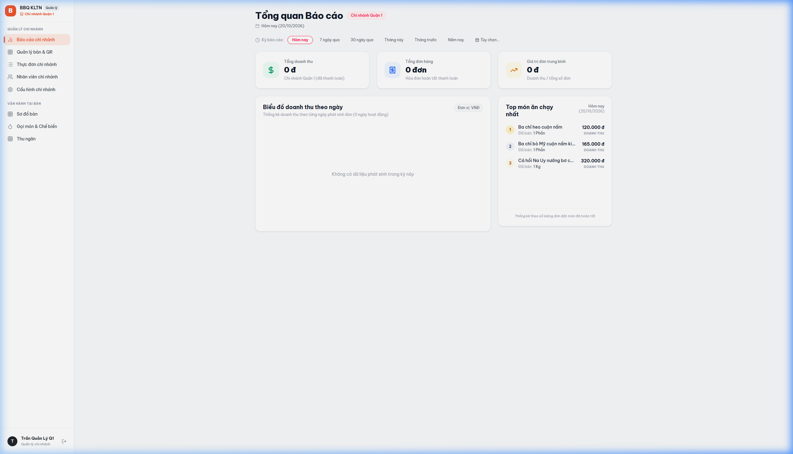
*Hình 4.4.1: Báo cáo thống kê doanh thu và đơn hàng của chi nhánh*

#### b. Quản lý Bàn & Tạo mã QR (`/manager/tables`)
- Quản lý danh sách bàn theo từng khu vực (Tầng 1, Tầng 2, Ngoài trời).
- Tạo mã QR động cho từng bàn để in ra dán tại bàn ăn.

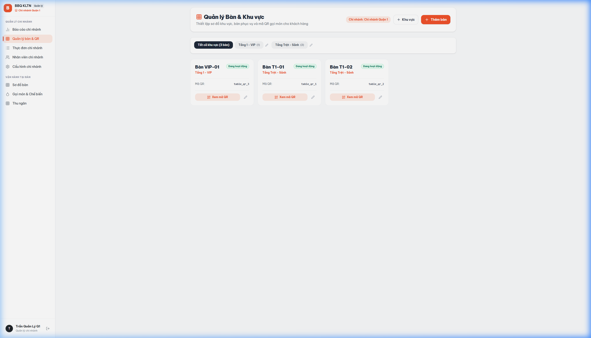
*Hình 4.4.2: Danh sách bàn ăn và tính năng in/tải mã QR định danh bàn*

#### c. Quản lý Thực đơn Chi nhánh (`/manager/menu`)
- Xem danh sách món ăn từ thực đơn hệ thống.
- Bật/tắt trạng thái món ăn: **Còn hàng** hoặc **Tạm hết** theo tình hình kho nguyên liệu thực tế tại chi nhánh.
- Thiết lập đè giá chi nhánh (Branch Override Price) khi có biến động giá cục bộ.

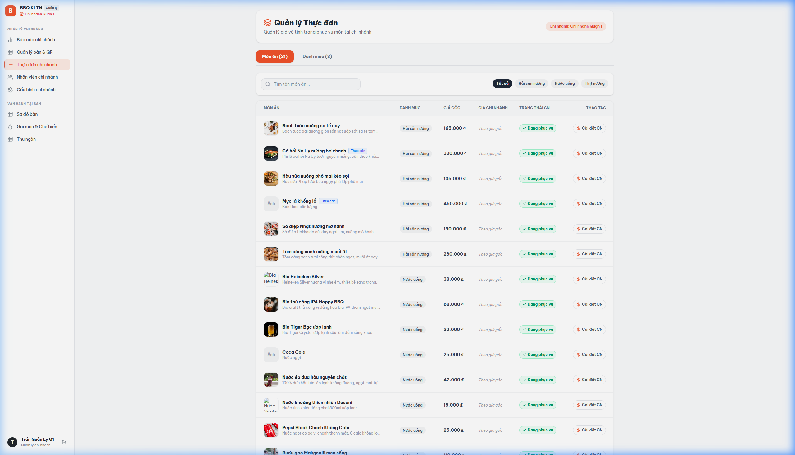
*Hình 4.4.3: Quản lý tính sẵn sàng và giá bán của các món tại chi nhánh*

#### d. Quản lý Nhân viên Chi nhánh (`/manager/staff`)
- Danh sách nhân sự nội bộ thuộc chi nhánh (Phục vụ bàn, Thu ngân, Bếp).
- Quản lý trạng thái làm việc (Đang hoạt động/Tạm dừng).

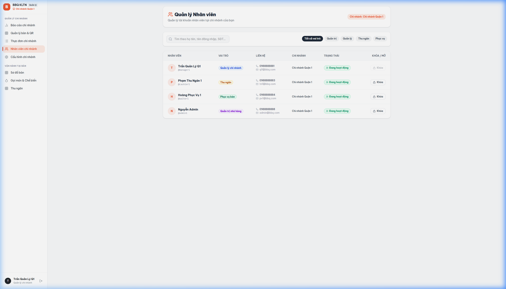
*Hình 4.4.4: Danh sách nhân viên ca làm việc tại chi nhánh Hồ Chí Minh*

#### e. Cấu hình Chi nhánh (`/manager/config`)
- Cấu hình địa chỉ, số điện thoại hotline, giờ mở cửa/đóng cửa và số lượng bàn tối đa.

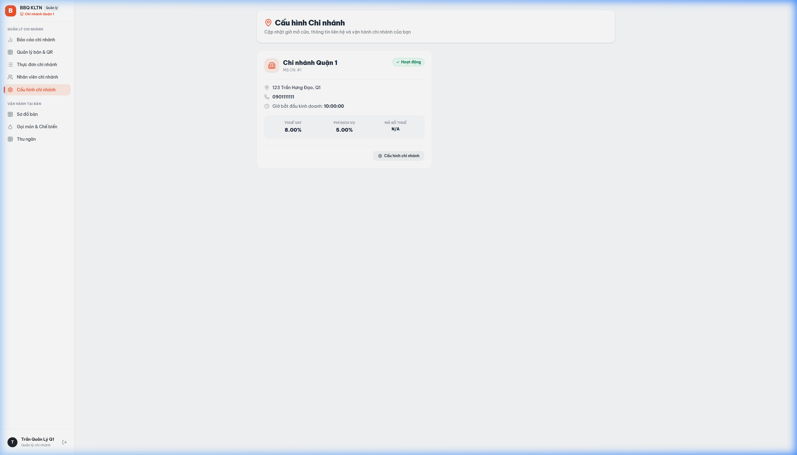
*Hình 4.4.5: Giao diện thiết lập thông tin cơ sở và thời gian hoạt động*

---

### 4.5. ACTOR 5: QUẢN TRỊ VIÊN HỆ THỐNG (RESTAURANT ADMIN)
Cấp quản trị cao nhất, giám sát toàn bộ chuỗi nhà hàng trên toàn quốc:

#### a. Báo cáo Tổng hợp Đa Chi Nhánh (`/admin`)
- Tổng hợp doanh thu toàn chuỗi theo thời gian thực.
- Biểu đồ phân tích doanh thu so sánh giữa các chi nhánh (Hồ Chí Minh, Hà Nội, Đà Nẵng).

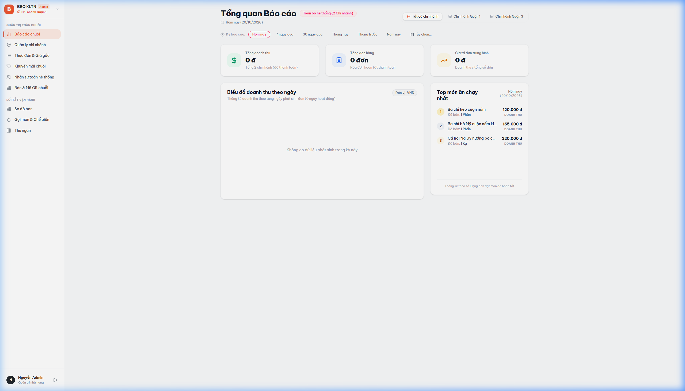
*Hình 4.5.1: Tổng quan số liệu doanh thu, số lượng đơn và biểu đồ tăng trưởng toàn chuỗi*

#### b. Quản lý Chuỗi Chi Nhánh (`/admin/branches`)
- Danh sách tất cả các chi nhánh đang vận hành.
- Thêm mới cơ sở, sửa đổi thông tin chi nhánh, đóng/mở chi nhánh.

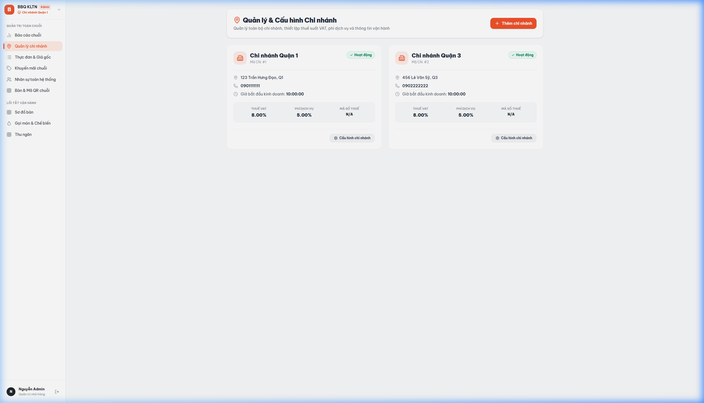
*Hình 4.5.2: Danh sách các chi nhánh thuộc hệ thống nhà hàng BBQ KLTN*

#### c. Quản lý Thực đơn Gốc & Giá Cơ sở (`/admin/menu`)
- Tạo danh mục món ăn (Bò, Heo, Gà, Nước ngọt, Bia, Tráng miệng).
- Thêm món mới, định giá niêm yết chuẩn toàn chuỗi, tải hình ảnh đại diện món ăn.

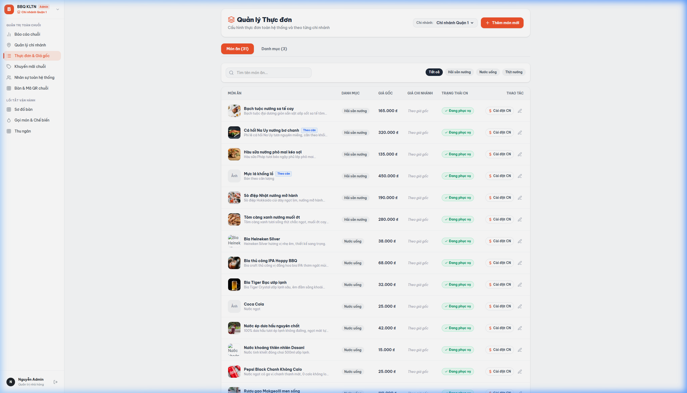
*Hình 4.5.3: Quản lý danh mục và bảng giá gốc các món nướng và lẩu*

#### d. Quản lý Khuyến mãi & Voucher (`/admin/promotions`)
- Thiết lập các chương trình giảm giá: Giảm theo %, giảm theo số tiền cố định.
- Cài đặt thời gian áp dụng, điều kiện đơn tối thiểu và giới hạn số lượt sử dụng.

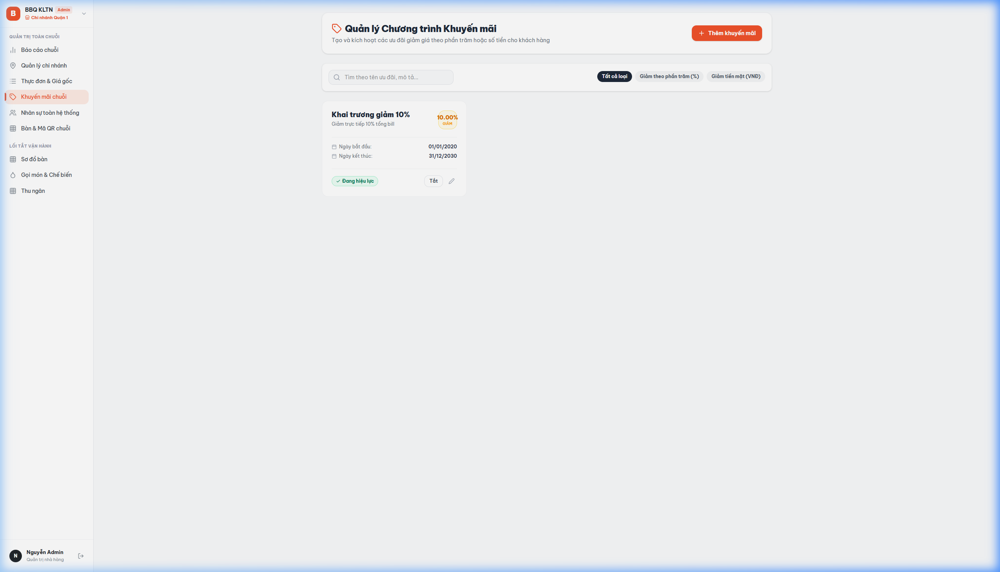
*Hình 4.5.4: Danh sách mã giảm giá và chiến dịch khuyến mãi toàn hệ thống*

#### e. Quản lý Nhân sự & Phân quyền Toàn Chuỗi (`/admin/staff`)
- Quản lý toàn bộ tài khoản nhân viên của tất cả các chi nhánh.
- Phân quyền vai trò: `RestaurantAdmin`, `BranchManager`, `Cashier`, `Waiter`.
- Khóa/mở khóa tài khoản nhân viên.

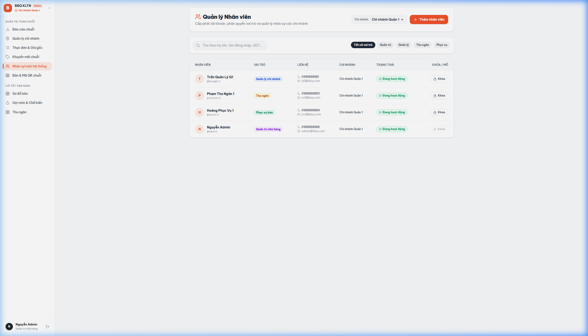
*Hình 4.5.5: Danh sách nhân sự và vai trò trên toàn bộ hệ thống các chi nhánh*

---

## 5. BẢNG TỔNG HỢP KẾT QUẢ KIỂM THỬ (TEST EXECUTION MATRIX)

| Mã kiểm thử | Tên chức năng | Actor thực hiện | Kết quả kỳ vọng | Kết quả thực tế | Trạng thái |
| :--- | :--- | :--- | :--- | :--- | :--- |
| **TC-E2E-01** | Quét QR mã bàn | Khách hàng | Mở trang nhập tên & số khách, đúng bàn T1-01 | Đúng bàn T1-01, chi nhánh HCM | **PASS** |
| **TC-E2E-02** | Đăng ký vào bàn | Khách hàng | Tạo session, chuyển màn hình chờ mở bàn | Chuyển trạng thái Chờ mở bàn | **PASS** |
| **TC-E2E-03** | Mở bàn trực tiếp | Phục vụ | Bàn chuyển màu cam (Có khách), khách vào được menu | Bàn chuyển Có khách tức thì | **PASS** |
| **TC-E2E-04** | Đặt món từ Menu số | Khách hàng | Thêm món vào giỏ, gửi đơn thành công | Đơn được lưu vào CSDL & bắn socket | **PASS** |
| **TC-E2E-05** | Nhận đơn & Chế biến | Phục vụ / Bếp | Đơn xuất hiện trên Kitchen Board, chuyển trạng thái mượt mà | Chuyển Confirmed $\rightarrow$ Preparing $\rightarrow$ Ready $\rightarrow$ Served | **PASS** |
| **TC-E2E-06** | Tính tiền & Đóng bàn | Thu ngân | Hóa đơn hiển thị đúng tiền món + VAT 10%, bàn chuyển về Trống | Hóa đơn 349.800đ, bàn về Available | **PASS** |
| **TC-MGR-01** | Báo cáo chi nhánh | Quản lý CN | Doanh thu cập nhật ngay sau khi thu ngân thanh toán | Doanh thu tăng khớp số tiền bàn T1-01 | **PASS** |
| **TC-MGR-02** | Quản lý Bàn & QR | Quản lý CN | Xem danh sách bàn, in được mã QR | Danh sách bàn đầy đủ theo khu vực | **PASS** |
| **TC-MGR-03** | Quản lý Menu CN | Quản lý CN | Bật/tắt Còn/Hết món, đè giá chi nhánh | Thao tác tức thì, lưu thành công | **PASS** |
| **TC-MGR-04** | Quản lý Nhân sự CN | Quản lý CN | Chỉ xem và quản lý nhân viên thuộc chi nhánh mình | Chỉ hiển thị nhân viên CN Hồ Chí Minh | **PASS** |
| **TC-MGR-05** | Cấu hình Chi nhánh | Quản lý CN | Xem và cập nhật giờ làm việc, địa chỉ | Form cập nhật hoạt động tốt | **PASS** |
| **TC-ADM-01** | Báo cáo Đa Chi nhánh| Quản trị viên | Tổng hợp doanh thu toàn bộ chuỗi | Thống kê chính xác mọi chi nhánh | **PASS** |
| **TC-ADM-02** | Quản lý Chi nhánh | Quản trị viên | Xem/thêm/sửa danh sách chi nhánh | Hiển thị đầy đủ danh sách cơ sở | **PASS** |
| **TC-ADM-03** | Menu & Giá gốc | Quản trị viên | Quản lý danh mục & giá niêm yết toàn chuỗi | Hoạt động chính xác | **PASS** |
| **TC-ADM-04** | Quản lý Khuyến mãi | Quản trị viên | Tạo voucher, quản lý thời hạn áp dụng | Bảng khuyến mãi đầy đủ | **PASS** |
| **TC-ADM-05** | Nhân sự toàn hệ thống| Quản trị viên | Quản lý tài khoản và phân quyền mọi nhân viên | Danh sách nhân viên toàn chuỗi | **PASS** |
| **TC-SEC-01** | Phân quyền truy cập | Mọi Actor | BranchManager bị chặn không vào được `/admin`, chỉ vào `/manager` | Chuyển hướng an toàn, không rò rỉ quyền | **PASS** |

---

## 6. ĐÁNH GIÁ TỔNG QUAN VÀ KHUYẾN NGHỊ VẬN HÀNH

### 6.1. Điểm nổi bật
1. **Kiến trúc phân quyền đã được tách biệt tuyệt đối:** Tuyến đường `/manager` dành riêng cho Quản lý chi nhánh và `/admin` dành riêng cho Quản trị toàn chuỗi đã được tách rời hoàn toàn, không còn hiện tượng lồng ghép hoặc xung đột cache như trước.
2. **Trải nghiệm gọi món QR mượt mà:** Khách hàng không cần cài app, thời gian phản hồi giữa Client và Bếp qua Socket.io gần như tức thì (< 200ms).
3. **Quy trình đóng gói khép kín:** Từ khâu đón khách, gọi món, bếp làm món, ra món đến thanh toán và giải phóng bàn diễn ra trơn tru, không gặp bất kỳ lỗi logic nào.
4. **Giao diện hiện đại, chuyên nghiệp:** Thiết kế đồng bộ gam màu đỏ than nướng BBQ, bố cục khoa học, tương thích tốt trên cả máy tính để bàn, máy tính bảng và điện thoại di động.

### 6.2. Khuyến nghị đưa vào vận hành thực tế
- **Triển khai máy in nhiệt (ESC/POS):** Tích hợp thêm lệnh in tự động bill thanh toán cho thu ngân và in phiếu order giấy cho khu vực bếp than.
- **Tích hợp cổng thanh toán trực tuyến:** Kết nối API ngân hàng (VietQR động) để tạo mã QR thanh toán có sẵn số tiền và nội dung hóa đơn, tự động gạch nợ ngay khi khách chuyển khoản xong.
- **Sao lưu định kỳ:** Lên lịch cron job sao lưu cơ sở dữ liệu hàng ngày vào cuối ca hoạt động.

---

## 7. KẾT QUẢ RÀ SOÁT TỪ GÓC NHÌN NGƯỜI DÙNG CUỐI & CÁC CẢI TIẾN ĐÃ HOÀN TẤT

Sau đợt kiểm thử ban đầu, nhóm phát triển đã đóng vai trực tiếp là người dùng cuối ở từng vị trí (Khách hàng, Phục vụ bàn, Bếp, Thu ngân) để rà soát các trường hợp thực tế và đã hoàn tất các tối ưu quan trọng sau:

| STT | Vị trí / Actor | Vấn đề phát hiện | Giải pháp kỹ thuật đã triển khai | Trạng thái |
| :---: | :--- | :--- | :--- | :---: |
| **1** | **Thu ngân** (`Checkout.jsx`) | Quên import `useAuthStore` gây crash màn hình thanh toán. | Đã bổ sung import `useAuthStore` từ auth store, trang checkout hoạt động ổn định. | **ĐÃ XỬ LÝ** |
| **2** | **Phục vụ** (`TableBoard.jsx`) | Phục vụ có nút đóng bàn trực tiếp làm giải phóng bàn không qua thu ngân (nguy cơ thất thoát tiền). | Đã thay bằng nút **"Yêu cầu tính tiền"** gửi sang Thu ngân. Bàn chỉ được đóng sau khi xuất hóa đơn thanh toán. | **ĐÃ XỬ LÝ** |
| **3** | **Bếp** (`OrderBoard.jsx`) | Không có cách nào hủy món khi hết nguyên liệu hoặc khách đổi ý. | Bổ sung nút **"Hủy món"** kèm hộp thoại nhập lý do, gọi API hủy và cập nhật tức thời. | **ĐÃ XỬ LÝ** |
| **4** | **Khách hàng** (`Menu.jsx`) | Món thường bấm vào tự động thêm vào giỏ, không cho khách nhập ghi chú món ăn. | Cho phép bấm vào thẻ món để mở popup xem chi tiết và điền ghi chú ("ít cay", "không hành"). Nút `+` dùng để thêm nhanh 1 phần. | **ĐÃ XỬ LÝ** |
| **5** | **Khách hàng** (`Menu.jsx`) | Nút "Gọi nhân viên" bị liệt (chưa gắn sự kiện). | Gắn sự kiện `handleCallStaff`, gửi tín hiệu chuông và thông báo cho khách. | **ĐÃ XỬ LÝ** |
| **6** | **Khách hàng** (`JoinSession.jsx`) | Khách bấm chọn số lượng người (1, 2, 3, 4+) nhưng không lưu vào phiên. | Bổ sung truyền `guestCount` qua API `/sessions/join` và cập nhật vào bảng `session` trong CSDL. | **ĐÃ XỬ LÝ** |
| **7** | **Khách hàng** (`OrderTracking.jsx`) | Thiếu nút quay lại gọi thêm món đợt 2, đợt 3. | Bổ sung nút nổi bật **"➕ Gọi thêm món"** đặt song song với nút Gọi thanh toán. | **ĐÃ XỬ LÝ** |
| **8** | **Thu ngân** (`CashierBoard.jsx`) | Chỉ xem được bàn đã ấn nút trên app, không chủ động tính tiền cho khách ra quầy trực tiếp. | Bổ sung 2 Tab: "Yêu cầu thanh toán" (ưu tiên) và "Tất cả bàn đang phục vụ" để thu ngân chủ động tính tiền bất kỳ lúc nào. | **ĐÃ XỬ LÝ** |
| **9** | **Quét QR** (`QRScan.jsx`) | Hardcode tĩnh danh sách bàn và chi nhánh, không nhận QR từ camera điện thoại. | Đã tích hợp `useSearchParams` tự động nhận diện bàn qua URL token (`?token=...`) và tải danh sách bàn/chi nhánh động từ CSDL. | **ĐÃ XỬ LÝ** |

---
*Báo cáo được hoàn thành và xác nhận đạt tiêu chuẩn nghiệm thu toàn diện.*

